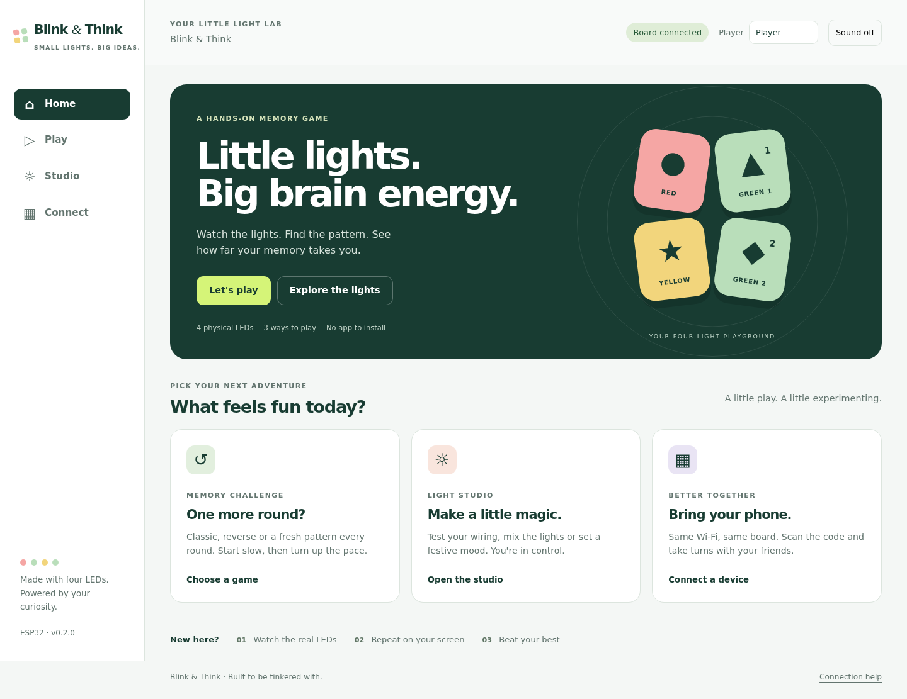
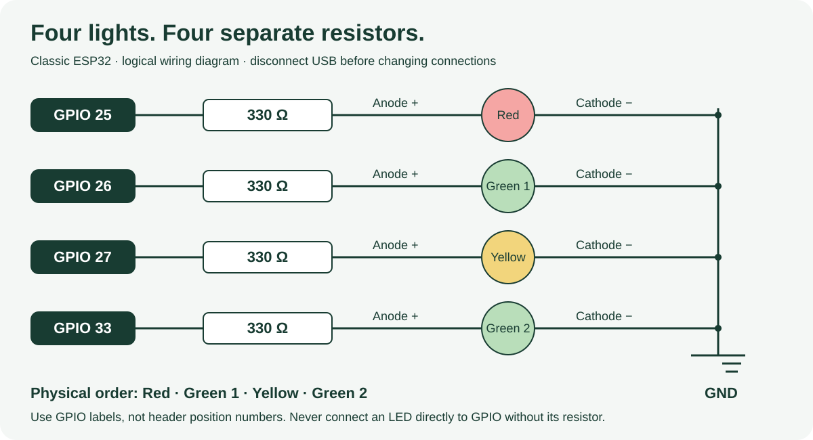

# Blink & Think

[](https://github.com/DimitarDTsonev/blink-and-think/actions/workflows/checks.yml)

**Little lights. Big brain energy.** A DIY memory game and light studio built with an ESP32, four LEDs, and a browser.

Watch the physical lights, repeat their pattern on a phone or computer, and try to beat your best. Two green LEDs add a twist: the right green number earns a full point; the other green earns half.

The ESP32 hosts the entire application on your local Wi-Fi. No cloud account, mobile app, external font service, or runtime internet connection is required.



[Build the hardware](docs/hardware.md) · [Install & connect](docs/getting-started.md) · [Development guide](docs/development.md) · [API](docs/api.md) · [MIT license](LICENSE)

## Try it before building

Download the source, then open **[preview/index.html](preview/index.html)** in your browser. It is a self-contained interactive demo: play with virtual LEDs, explore the studio, and review the desktop/mobile layouts. It does **not** connect to a physical ESP32. Demo scores reset on reload.

GitHub's file viewer displays HTML source; download the file and open it locally to run it. Alternatively, from the project root:

```sh
python tools/preview.py
```

Open **http://localhost:8765/preview/**. Stop the preview server with Ctrl+C.

## What you can do

| Experience | Features |
| --- | --- |
| Memory game | Classic, Reverse and Shuffle; 2 / 1 / 0.5 / 0.25 second intervals; up to 32 lights |
| Scoring | 1 point for the exact LED, 0.5 for the other green, wrong color ends the turn |
| Light studio | Individual toggles, all on/off, shared brightness, Chase, Blink, Christmas, Breathe and Bounce |
| Wiring test | Each LED lights for 1.5 seconds, with a matching on-screen highlight and a 0.3 second gap |
| Desktop | Spacious game screen and keyboard shortcuts 1–4, in physical LED order |
| Phone | Large touch targets, bottom navigation, local join QR code and iPhone Home Screen instructions |
| Shared board | One active session at a time; other devices watch and take the next turn |

Best scores are stored on the ESP32 separately for every mode and speed. Sessions end after 15 seconds without the owner's heartbeat; studio outputs then switch off. Each game answer allows 30 seconds while the owner remains connected.

## The reference build

This project began as a first ESP32 starter-kit project. The kit had no white LED, so it uses **red, green 1, yellow, green 2** in that physical order.

| Part | Quantity | Reference choice |
| --- | ---: | --- |
| ESP32 development board | 1 | ZY-ESP32, classic ESP32-D0WD-V3, 4 MB flash, micro-USB, FTDI USB-to-serial |
| Solderless breadboard | 1 | Full-size breadboard with numbered rows |
| Red LED | 1 | Ordinary two-leg through-hole LED |
| Green LED | 2 | Ordinary two-leg through-hole LEDs |
| Yellow LED | 1 | Ordinary two-leg through-hole LED |
| Resistors | 4 | One 330 Ω resistor per LED; 220–330 Ω supported by the reference wiring |
| Jumper wires | 9 | Five board-to-breadboard connections and four ground links |
| USB **data** cable | 1 | Suitable for the board's connector |
| Wi-Fi router | 1 | 2.4 GHz network available to ESP32 |

No relay, external display, battery, soldering, or buzzer is needed. Sound comes from the browser after you enable it.

### Pin mapping

| Physical position | LED | GPIO label | API color ID | Keyboard |
| --- | --- | --- | ---: | --- |
| 1 | Red | D25 / GPIO25 | 0 | 1 |
| 2 | Green 1 | D26 / GPIO26 | 1 | 2 |
| 3 | Yellow | D27 / GPIO27 | 3 | 3 |
| 4 | Green 2 | D33 / GPIO33 | 2 | 4 |



**Unplug USB before changing wiring.** Each LED needs its own series resistor. The long leg is normally the anode (+); the short leg and flat rim identify the cathode (−). Use the labels on your board, not pin position numbers. Detailed, numbered breadboard instructions are in [the hardware guide](docs/hardware.md).

## Software used

- **VS Code + PlatformIO** for editing, building and uploading.
- **C++ / Arduino-ESP32** for GPIO, game rules, timers and HTTP routes.
- Built-in **WiFi**, **WebServer**, **ESPmDNS**, and **Preferences** libraries.
- **HTML, CSS and vanilla JavaScript** for the interface; **Web Audio** for phone/computer sound.
- Locally bundled **qrcode-generator 1.4.4** for QR codes, with its MIT notice retained.
- **C++ host tests**, a browser-only simulator and **Playwright** for development checks.

Pinned build inputs: PlatformIO Core **6.2.0** and `platformio/espressif32@8.0.0`. The validated local build resolved Arduino-ESP32 **3.3.12**. This profile targets a **classic ESP32**, not ESP32-C3/S3 or ESP32-CAM without adaptation.

## Build, upload, play

1. Assemble the circuit using [hardware.md](docs/hardware.md).
2. Install VS Code and its **PlatformIO IDE** extension. Open this project folder, the one containing `platformio.ini`.
3. Open a PlatformIO terminal and run:

   ```sh
   pio run
   pio device list
   pio run --target upload
   pio device monitor --baud 115200
   ```

   Port selection is automatic. If you have multiple serial devices, use `--upload-port COM5` for upload and `--port COM5` for monitoring, substituting your actual port. Linux/macOS examples and WSL USB attachment are in [getting-started.md](docs/getting-started.md).

4. On first boot, read the unique setup password in Serial Monitor. Join **ESP32-Color-Setup**, then open **http://192.168.4.1**.
5. Select your own 2.4 GHz Wi-Fi and enter its password locally. Let the board restart, then return the phone to that Wi-Fi.
6. Open **http://color-game.local** or the actual IP printed in Serial Monitor. On a computer, open **Connect** to display the device's join QR code.
7. Open **Studio → Test all lights** to confirm Red → Green 1 → Yellow → Green 2. Then end the studio session and choose **Play**.

Uploading replaces the board's current program. It does not normally erase the stored Wi-Fi credentials or scores. Web assets are embedded into firmware; no filesystem upload is needed. After changing HTML/CSS/JS, rebuild and upload firmware for the board to serve those changes.

## Rules at a glance

- Start with 3 lights. A successful round increases the sequence length by one.
- **Classic:** repeat the pattern in order. **Reverse:** repeat it backwards. **Shuffle:** each round generates a completely new pattern.
- Exact LED: **1 point**. Other green number: **0.5 points**, and the turn continues. Another color: the turn ends.
- The maximum is 30 completed rounds, 32 lights in the final round and **525 points** for all exact answers.
- Game playback is shown only on physical LEDs. The real API does not reveal the sequence. The offline preview has a clearly labeled virtual board instead.
- Everyone playing must be able to see the physical board. This is turn-taking, not simultaneous multiplayer or an automatic queue.
- Scores save when a turn ends, including cancellation or disconnection. Pulling power during an unfinished turn loses that turn's score.

## Project layout

```text
include/            Portable game/controller logic and hardware pin mapping
src/main.cpp        ESP32 startup, Wi-Fi, persistence and HTTP API
web/                Embedded application, setup screen and vendored QR code
preview/            Self-contained demo HTML and browser-only simulator
tests/              C++ logic, browser integration and optional device smoke tests
tools/              Preview builder, validation and source packaging
.github/            CI workflow, issue forms and pull request template
docs/               Build guide, architecture, API, screenshots and release notes
```

## Development checks

Node/Python are development tools; they do not run on the board.

```sh
python tools/test_logic.py       # Requires g++ or clang++ with C++17
python tools/check_source.py
python tools/build_preview.py
npm ci
npx playwright install chromium
npm test
pio run
```

See [development.md](docs/development.md) for portable setup, browser environment overrides and the optional hardware test. The GitHub workflow runs checks and a firmware build; it never uploads to a board, publishes a site or creates a release.

## Status & limits

Version **0.2.0 is the initial public source version**. Desktop/mobile browser tests use Chromium and a simulated API, and the firmware builds for the reference ESP32 profile. The earlier hardware version has been tested on the reference board; the redesigned version still needs an actual iPhone/board acceptance check. Publishing this repository does not update the physical board. See [review.md](docs/review.md).

Use a trusted local network. The app uses HTTP and session identifiers, not user authentication or TLS. Do not expose the board through router port forwarding. Wi-Fi credentials are stored in the ESP32's NVS; this project does not configure flash encryption. Read [SECURITY.md](SECURITY.md) before sharing device dumps or logs.

The timed LED test compensates approximately for network latency; browser highlights are not guaranteed to be perfectly simultaneous with electrical outputs. Unusual boards, resistor values, guest-network isolation and phone browser behavior may require adjustments. See [troubleshooting.md](docs/troubleshooting.md).

## Contributing & license

Ideas and fixes are welcome. Start with [CONTRIBUTING.md](CONTRIBUTING.md) and the [code of conduct](CODE_OF_CONDUCT.md). This project is MIT-licensed; bundled and build-time dependencies retain their own terms. See [LICENSE](LICENSE) and [THIRD_PARTY_NOTICES.md](THIRD_PARTY_NOTICES.md).
