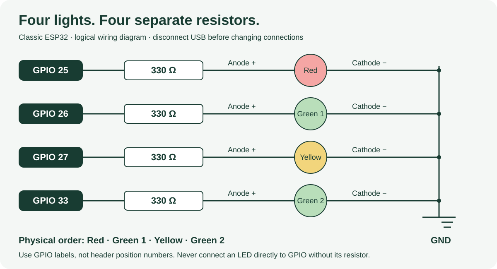

# Build the four-light board

This guide reproduces the reference wiring without soldering. Use a classic ESP32 development board with clearly marked GPIO25, GPIO26, GPIO27, GPIO33 and GND. A different ESP32 family needs a separate pin review.

## Gather the parts

- 1 ESP32 development board, 1 breadboard and a USB data cable.
- 1 red LED, 2 green LEDs and 1 yellow LED, each with two legs.
- 4 separate 330 Ω resistors (220–330 Ω is the reference range).
- 5 female-to-male jumpers if the board has male headers, plus 4 male-to-male ground jumpers.

The reference board is labeled **ZY-ESP32**, uses a classic **ESP32-D0WD-V3**, has **4 MB flash**, micro-USB, an FTDI serial bridge and an onboard 3.3 V regulator. The regulator marking is not the ESP32 model. Similar boards can use CP210x or CH340 instead; USB drivers may differ.

## Understand the breadboard

With the printed letters upright, A–E at the **same number** are connected internally. For example, A5 and C5 share a connection; A5 and A6 do not. The center gap separates A–E from F–J. The long edge rails are separate and can be split; this layout does not use them.

An LED is directional. The longer leg is usually **anode (+)**. The shorter leg and flat edge on the rim identify **cathode (−)**. If the legs were cut, inspect the flat rim or use a multimeter. A resistor has no direction.

## Wire it, one step at a time

1. **Unplug USB and any other power.** Leave the ESP32 beside the breadboard so you can read its pin labels.
2. Place the red LED: anode in **A5**, cathode in **A6**.
3. Place Green 1: anode **A15**, cathode **A16**.
4. Place the yellow LED: anode **A25**, cathode **A26**.
5. Place Green 2: anode **A35**, cathode **A36**.
6. Add one resistor per LED, using the pairs below. Its two legs must go into different numbered connection groups.
7. Connect the four GPIO jumpers using the table. Push the sockets fully onto the correct **labeled GPIO pins**.
8. Connect **GND on ESP32 to A1**.
9. Add four ground jumpers: **E6 → B1**, **E16 → C1**, **E26 → D1**, **E36 → E1**. A1–E1 are the shared ground group.
10. Check that bare legs do not touch neighboring branches. Verify each resistor value and each LED's direction before powering up.

| LED | Anode / cathode | Resistor ends | GPIO jumper | Reference wire color |
| --- | --- | --- | --- | --- |
| Red | A5 / A6 | C5 ↔ C9 | GPIO25 → E9 | White |
| Green 1 | A15 / A16 | C15 ↔ C19 | GPIO26 → E19 | Blue |
| Yellow | A25 / A26 | C25 ↔ C29 | GPIO27 → E29 | Gray |
| Green 2 | A35 / A36 | C35 ↔ C39 | GPIO33 → E39 | Purple |

Wire colors are labels for convenience; the electrical connections are what matter. If you already have a working circuit with the same electrical mapping, you do not need to move components to these holes.



Each branch is:

```text
ESP32 GPIO ── 330 Ω resistor ── LED anode (+) → LED cathode (−) ── GND
```

Do not connect an LED directly across GPIO and GND without a resistor. Do not connect the GPIO signal wires to VIN/5V. Power the reference setup from the board's USB connector. PWM brightness control does not replace a current-limiting resistor.

## First powered check

After [uploading and connecting](getting-started.md):

1. Open **Studio** in the browser.
2. Choose **Test all lights · 1.5s each**. The board is claimed automatically if free.
3. Expect **Red → Green 1 → Yellow → Green 2**. Each stays on for 1.5 seconds at 50% brightness, separated by a 0.3 second dark gap. All switch off at the end.
4. Compare the physical LED with the highlighted screen button. A wrong color usually means a GPIO mapping mismatch. An unlit branch can mean reversed LED polarity, a misplaced resistor/jumper, or a poor connection.
5. Choose **End studio session** before playing.

Unplug power before correcting a connection. Photographs alone cannot verify resistor values or hidden breadboard contacts.

## Changing the hardware

`include/hardware.h` stores **logical order**, not physical order:

```cpp
constexpr unsigned LED_PINS[] = {25, 26, 33, 27}; // Red, Green 1, Green 2, Yellow
```

The physical order is logical IDs **0, 1, 3, 2**. The scoring rule treats IDs **1 and 2** as the two greens. If you change colors, also review that rule, the UI labels, simulator, tests and documentation.

`BUZZER_PIN = -1` disables the optional passive piezo output. Browser sound works without it. An external buzzer or display is not part of this build; check the specific component's voltage/current and wiring before enabling it. The relay module from some starter kits is not used.
